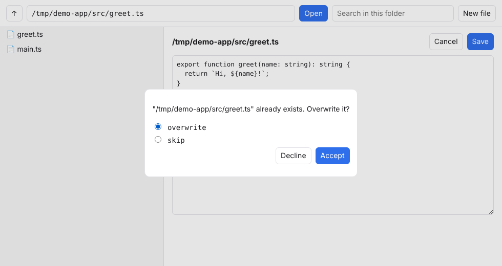

# browser

A local web UI for one workspace. You can browse folders, view text and
images, search, and edit, create, or delete files. filesystem-mcp does the
file work, so its rules hold in the page too: secret files never show up, and
a folder outside the workspace stays closed until you allow it. When the
server wants your OK before replacing a file or deleting a non-empty folder,
the page shows its question as a dialog built from the form the server sends.



## Run

Requires Node 24+.

```sh
npm install
node server.ts <dir> [--port 8787] [--read-only]
```

Then open the printed `http://127.0.0.1:<port>/` address. The app listens on
`127.0.0.1` only. `--read-only` starts the server with `--read-only`, and the
page hides its edit, new, and delete buttons. `--port 0` picks a free port.
`FS_MCP_BIN` points the app at a local `dist/index.js` instead of the npm
package.

Type any path in the top box and press Enter. A path outside the workspace
makes the server ask for access first; once you accept, it stays allowed
until the app stops.

## How it works

`server.ts` holds one MCP client and exposes four JSON routes; `index.html`
is the whole UI, with no build step. Each part maps to one piece of the MCP
client API:

- **Manual multi-round-trip mode.** The client is created with
  `inputRequired: { autoFulfill: false }` and calls tools with
  `allowInputRequired: true`. When the server needs a confirmation,
  `callTool()` does not call an elicitation handler; it returns
  `{ resultType: 'input_required', inputRequests, requestState }`. The route
  passes that to the page, the page shows each request as a dialog, and then
  repeats the same call with `inputResponses` (keyed like `inputRequests`)
  and the unchanged `requestState`, until a normal result comes back. This
  suits a web backend, because no request has to stay open while a person
  decides.
- **Protocol era.** `input_required` exists only in the 2026-07-28 revision,
  so `versionNegotiation` pins that revision instead of negotiating. The
  client still declares `elicitation: { form: {} }`, with no handler: without
  the capability the server refuses risky calls outright instead of asking.
- **The forms.** Every request is `elicitation/create` with one field: a
  boolean (granting one folder; accept means yes), an enum (`overwrite` or
  `skip`, `delete` or `skip`), or an array of enum values (granting several
  folders at once). The page builds radio buttons or checkboxes from the
  schema, so it never needs to know which question it is answering.
- **`requestState` is signed.** The server signs it with an HMAC and rejects
  a changed one (`Invalid or expired requestState`), so the page only
  carries it from one round to the next.
- **Reading files.** The viewer uses `resources/read` on
  `filesystem-mcp://file/{+path}`, with the path percent-encoded and `/`
  kept. Text arrives as `text`; images and other binaries as base64 `blob`.
  The server marks file reads cacheable for 5 seconds, and the client SDK
  honors that, so a read right after a save would return the old bytes. The
  `read` route passes `cacheMode: 'bypass'`.
- **Path completion.** The path box's suggestions come from
  `client.complete()` on the same resource template. The server completes
  absolute paths, paths relative to the root, and the roots themselves, and
  leaves out secret files.
- **Listing and search.** `stat` tells a folder from a file (and is the call
  that triggers the access question for a new path). `list` and
  `search_text` keep their rows in `_meta` (`entries`, `matches`); when
  `_meta.nextCursor` is set, "more…" repeats the call with `cursor`.
- **Errors.** A tool failure is a result with `isError`; a batch that failed
  for some paths reports them in `failures` or in `results[].error`. Thrown
  errors (an unknown tool, a file outside the roots in `resources/read`)
  become HTTP 500 with the message.
- **The local API.** Routes accept only `POST` with
  `content-type: application/json`, which another site's page cannot send
  without a CORS preflight this server never approves, and only with a
  `Host` of `127.0.0.1:<port>` or `localhost:<port>`, which stops DNS
  rebinding.

## Check

`npm test` runs `check.ts`: the real app and server, driven through the same
JSON routes the page uses, including an overwrite, a multi-folder grant, a
forged `requestState`, completions, an image, and `--read-only`. No browser
or network needed. Build the server first with `npm run build` at the
repository root.
